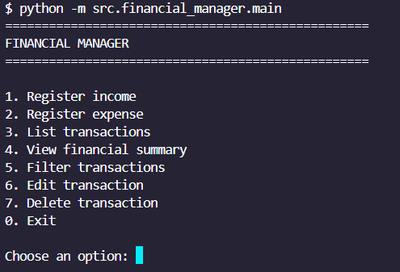
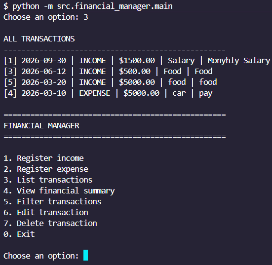
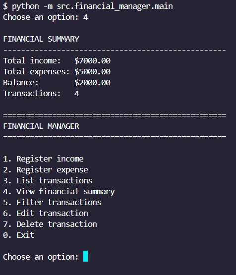

## Screenshots

### Main Menu



### Transactions



### Financial Summary




# Financial Manager

A command-line personal finance management application built with Python and SQLite.

The project demonstrates CRUD operations, SQL queries, business logic, input validation, financial summaries, filters, automated testing, and a layered project structure.

## Features

- Register income
- Register expenses
- List transactions
- Edit transactions
- Delete transactions
- Filter transactions by category
- Filter transactions by type
- Filter transactions by date range
- Financial summary
- Input validation
- Persistent SQLite database
- Automated tests

## Technologies

- Python
- SQLite
- SQL
- Pytest
- Git
- GitHub

## Project Structure

```text
financial-manager/
├── src/
│   └── financial_manager/
│       ├── __init__.py
│       ├── database.py
│       ├── main.py
│       ├── models.py
│       ├── repository.py
│       ├── services.py
│       └── validators.py
├── tests/
├── docs/
├── pyproject.toml
├── requirements.txt
└── README.md

----------------------------------

Architecture
The application is divided into several layers:
- main.py — CLI and user interaction
- services.py — business logic
- repository.py — database access and SQL operations
- models.py — application data models
- validators.py — validation rules
- database.py — SQLite connection and initialization

SQL Concepts Used
The project includes:
- INSERT
- SELECT
- UPDATE
- DELETE
- WHERE
- ORDER BY
- SUM
- COUNT
- GROUP BY
- CASE
- Parameterized queries

---Running the Application
Create and activate a virtual environment.

---Install dependencies:
python -m pip install -r requirements.txt

---Run the application from the project root:
python -m src.financial_manager.main

---Running Tests
python -m pytest


Example Workflow

The application allows users to:
1. Register income or expenses.
2. View all transactions.
3. Review their financial summary.
4. Filter transactions.
5. Edit existing transactions.
6. Delete transactions.


Validation

The CLI validates:
- Transaction amounts
- Transaction IDs
- Transaction types
- Dates
- Date ranges
- Invalid or missing records


Future Improvements

Possible future additions include:
- Graphical user interface
- Excel/CSV export
- User authentication
- Data visualization
- Budget management


